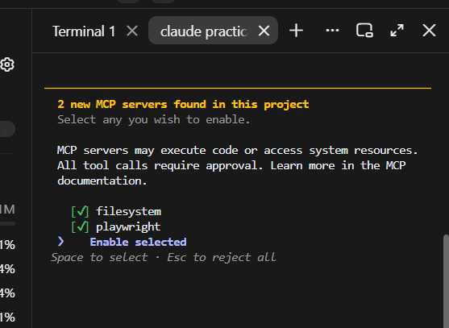
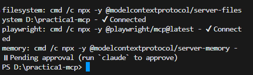
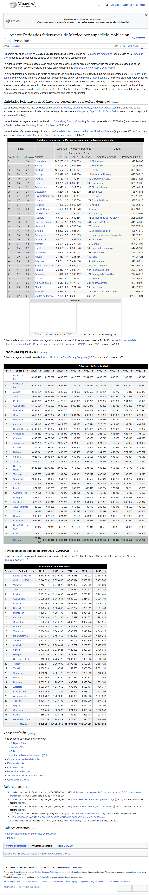

# Práctica 1 · Conectar servidores MCP a un agente

## 1. Descripción

En esta práctica conecté servidores del **Model Context Protocol (MCP)** a un agente de programación y los usé para resolver tareas con archivos y con el navegador.

- **Agente (host):** Claude Code **2.1.322** (CLI para Windows), modelo `claude-opus-5-5`
- **Sistema operativo:** Windows 11
- **Node.js:** v26.13.0 · **npx:** 11.20.0
- **Navegador:** Google Chrome, en modo con ventana (no headless)
- **Ruta de la práctica:** `D:\practica1-mcp`. La puse en `D:` para que la configuración no muestre el usuario de Windows. En los registros de evidencia, cualquier ruta con el usuario aparece como `TU_USUARIO`.

| Servidor | Paquete npm | Versión usada |
|---|---|---|
| filesystem | `@modelcontextprotocol/server-filesystem` | 2.2.0 |
| playwright | `@playwright/mcp` | 0.0.85 |
| memory (actividad D) | `@modelcontextprotocol/server-memory` | 2.1.0 |

Arquitectura: Claude Code es el **host**. Adentro tiene un **cliente MCP** por cada servidor, y cada cliente habla con su servidor por **JSON-RPC sobre stdio**. El modelo nunca toca el disco ni el navegador: pide una herramienta y el servidor la ejecuta.

## 2. Requisitos y reproducción

**Requisitos**

- Node.js 18 o superior (incluye `npx`)
- Google Chrome (lo usa `playwright`)
- Git y una cuenta de GitHub
- Claude Code (CLI). En Windows: `irm https://claude.ai/install.ps1 | iex`, y la primera vez iniciar sesión con `claude`.

**Pasos para repetir la práctica desde cero**

1. Clona el repositorio y entra a la carpeta:
   ```powershell
   git clone https://github.com/perezcarlosalberto/U3Practica1-Servidor-MCP-con-agente.git
   cd U3Practica1-Servidor-MCP-con-agente
   ```
2. **Cambia la ruta en `.mcp.json`** por la ruta absoluta de tu carpeta, en dos lugares: el último argumento de `filesystem` y la variable `MEMORY_FILE_PATH` de `memory`. En JSON las barras invertidas van dobles, por ejemplo `C:\\Users\\TU_USUARIO\\practica1-mcp`.
   Otra opción es borrar `.mcp.json` y registrar los servidores con los comandos de la sección 3.
3. Ejecuta `claude` dentro de la carpeta y **aprueba** los servidores del proyecto cuando te lo pida.
4. Escribe `/mcp` o, desde otra terminal, ejecuta `claude mcp list`. Los servidores deben aparecer como `Connected`.
5. Pega en el chat el texto de cada archivo de `instrucciones/` y aprueba cada llamada.

> La primera vez, un servidor puede marcar *timeout* mientras `npx` descarga el paquete. Si pasa, vuelve a ejecutar `claude mcp list`.

## 3. Servidores MCP

Registré los servidores con alcance de proyecto (`--scope project`), así que la configuración queda en [`.mcp.json`](.mcp.json). En Windows, `npx` se invoca a través de `cmd /c`, y los nombres de los paquetes van entre comillas porque PowerShell trata `@` de forma especial.

```powershell
claude mcp add --scope project filesystem -- cmd /c npx -y "@modelcontextprotocol/server-filesystem" "$PWD"
claude mcp add --scope project playwright -- cmd /c npx -y "@playwright/mcp@latest"
claude mcp add --scope project memory -e MEMORY_FILE_PATH=D:\practica1-mcp\salida\memoria.jsonl -- cmd /c npx -y "@modelcontextprotocol/server-memory"
```

**Estado de los servidores**

Antes de aprobarlos ([`evidencias/00_mcp_list_pendiente.txt`](evidencias/00_mcp_list_pendiente.txt)):
```
filesystem: cmd /c npx -y @modelcontextprotocol/server-filesystem D:\practica1-mcp - ⏸ Pending approval (run `claude` to approve)
playwright: cmd /c npx -y @playwright/mcp@latest - ⏸ Pending approval (run `claude` to approve)
```

Pantalla de aprobación de Claude Code:



Después de aprobarlos ([`evidencias/02_mcp_list_conectados.txt`](evidencias/02_mcp_list_conectados.txt)):
```
filesystem: cmd /c npx -y @modelcontextprotocol/server-filesystem D:\practica1-mcp - √ Connected
playwright: cmd /c npx -y @playwright/mcp@latest - √ Connected
```

Captura de `claude mcp list` después de agregar el servidor de la actividad D:



`memory` aparece como *Pending approval* porque no lo aprobé en una sesión interactiva. En la actividad D lo cargué con `--mcp-config .mcp.json`, y el registro de esa sesión lo reporta conectado: `"memory","status":"connected"`.

**Herramientas que expone cada servidor** (según el registro de inicio de cada sesión)

| Servidor | Nº | Herramientas |
|---|---|---|
| filesystem | 16 | `read_text_file`, `read_file`, `read_media_file`, `read_multiple_files`, `write_file`, `edit_file`, `append_file`, `copy_file`, `move_file`, `create_directory`, `list_directory`, `list_directory_with_sizes`, `directory_tree`, `search_files`, `get_file_info`, `list_allowed_directories` |
| playwright | 25 | `browser_navigate`, `browser_navigate_back`, `browser_snapshot`, `browser_take_screenshot`, `browser_evaluate`, `browser_run_code_unsafe`, `browser_click`, `browser_type`, `browser_press_key`, `browser_hover`, `browser_drag`, `browser_drop`, `browser_fill_form`, `browser_select_option`, `browser_file_upload`, `browser_find`, `browser_handle_dialog`, `browser_wait_for`, `browser_tabs`, `browser_resize`, `browser_emulate_media`, `browser_console_messages`, `browser_network_request`, `browser_network_requests`, `browser_close` |
| memory | 9 | `create_entities`, `create_relations`, `add_observations`, `delete_entities`, `delete_observations`, `delete_relations`, `read_graph`, `search_nodes`, `open_nodes` |

En Claude Code, las herramientas MCP se nombran `mcp__servidor__herramienta`, por ejemplo `mcp__filesystem__read_text_file`.

### Cómo se ejecutaron las actividades

Para tener un registro completo de **cada llamada** (nombre, argumentos y resultado), ejecuté cada instrucción en modo no interactivo. Cargué solo los servidores de la práctica y **deshabilité las herramientas propias del agente**, para que la tarea solo pudiera resolverse por MCP:

```bat
:: Símbolo del sistema (cmd). La instrucción entra por stdin y el registro sale a un .jsonl.
claude -p --mcp-config .mcp.json --strict-mcp-config --allowedTools "mcp__filesystem,mcp__playwright" --disallowedTools "Bash,PowerShell,Write,Edit,Read,Glob,Grep,WebFetch,WebSearch,Agent,NotebookEdit" --output-format stream-json --verbose < instrucciones\actividad_a.txt > evidencias\actividad_a.jsonl
```

En la actividad C dejé permitido solo `mcp__filesystem`. En la D, `mcp__memory,mcp__filesystem`.

Los registros completos están en `evidencias/actividad_*.jsonl`, un evento JSON por línea. Al iniciar, cada sesión reportó `"mcp_servers": [{"name":"filesystem","status":"connected"}, {"name":"playwright","status":"connected"}]`.
Antes de cada llamada MCP, Claude Code usa su herramienta interna `ToolSearch` para cargar las definiciones de las herramientas que va a necesitar. En las tablas siguientes no la incluyo.

## 4. Actividades A, B y C

### Actividad A: lectura y escritura de archivos (filesystem)

**Instrucción:** [`instrucciones/actividad_a.txt`](instrucciones/actividad_a.txt) · **Registro:** [`evidencias/actividad_a.jsonl`](evidencias/actividad_a.jsonl) · Duración: unos 37 s

| # | Herramienta | Argumentos | Resultado del servidor |
|---|---|---|---|
| 1 | `mcp__filesystem__list_directory` | `D:\practica1-mcp\datos` | `[FILE] calificaciones.csv` |
| 2 | `mcp__filesystem__read_text_file` | `D:\practica1-mcp\datos\calificaciones.csv` | contenido del CSV (8 alumnos) |
| 3 | `mcp__filesystem__create_directory` | `D:\practica1-mcp\salida` | `Successfully created directory ...` |
| 4 | `mcp__filesystem__write_file` | `D:\practica1-mcp\salida\reporte.md` + tabla | `Successfully wrote to ...` |

**Orden de herramientas:** `list_directory` → `read_text_file` → `create_directory` → `write_file`.
El cálculo de los promedios lo hizo el modelo; ninguna herramienta calcula. `create_directory` no falla si la carpeta ya existe, así que el agente la llamó para asegurarse de que `salida/` estuviera ahí.

**Resultado:** [`salida/reporte.md`](salida/reporte.md). Tiene 8 alumnos: **6 aprueban y 2 no** (Diego Ruiz con 5.50 y Hector Vega con 5.33). El **promedio del grupo es 7.50**, como se esperaba.

| # | Nombre | Promedio | Estado |
|---|---|---|---|
| 1 | Carla Mendez | 9.50 | Aprueba |
| 2 | Gabriela Luna | 9.50 | Aprueba |
| 3 | Ana Torres | 9.00 | Aprueba |
| 4 | Elena Castro | 8.17 | Aprueba |
| 5 | Fabian Ortiz | 6.83 | Aprueba |
| 6 | Bruno Salas | 6.17 | Aprueba |
| 7 | Diego Ruiz | 5.50 | No aprueba |
| 8 | Hector Vega | 5.33 | No aprueba |

### Actividad B: de una página web a un CSV (playwright + filesystem)

**Instrucción:** [`instrucciones/actividad_b.txt`](instrucciones/actividad_b.txt) · **Registro:** [`evidencias/actividad_b.jsonl`](evidencias/actividad_b.jsonl) · Duración: unos 66 s

| # | Servidor | Herramienta | Qué hizo |
|---|---|---|---|
| 1 | playwright | `browser_navigate` | Abrió `https://es.wikipedia.org/?curid=5897912` («Anexo:Entidades federativas de México por superficie, población y densidad»). |
| 2 | filesystem | `list_allowed_directories` | En paralelo con el paso 1, confirmó que podía escribir en `D:\practica1-mcp`. |
| 3 | playwright | `browser_evaluate` | Con JavaScript buscó las tablas `table.wikitable` y solo encontró tablas de **población histórica**, que no eran las buscadas. |
| 4 | playwright | `browser_evaluate` | Listó **todas** las tablas de la página y encontró la correcta en la posición 0 (clase `sortable`). |
| 5 | playwright | `browser_evaluate` | Leyó la tabla completa como texto para identificar las columnas. |
| 6 | playwright | `browser_evaluate` | Extrajo las 32 filas, quitó los separadores de miles y generó el texto CSV. |
| 7 | **filesystem** | `write_file` | Escribió `salida/entidades.csv`. |
| 8 | playwright | `browser_take_screenshot` | Guardó la captura de la página completa en `salida/captura_entidades.png`. |
| 9 | playwright | `browser_close` | Cerró el navegador. |

**Cambio de servidor:** el agente cambió de playwright a filesystem en el **paso 7** (`write_file`), cuando ya tenía los datos, y volvió a playwright para la captura y el cierre. También usó filesystem al inicio (paso 2) para comprobar el directorio permitido.

**Cómo obtuvo los datos:** **ejecutando JavaScript** en la página con `browser_evaluate` (pasos 3 a 6). No usó `browser_snapshot`. Su primer intento eligió las tablas equivocadas y él mismo lo corrigió en el paso 4.

**Resultado:** [`salida/entidades.csv`](salida/entidades.csv) tiene un encabezado y **32 filas**. La primera es **Chihuahua, 247455 km²**.
El agente reportó que la población es la **estimación 2020**. También advirtió que la columna de densidad está rotulada **2015**, por lo que no coincide exactamente con población/superficie de 2020 (Chihuahua: 3 741 869 / 247 455 ≈ 15.1, pero la tabla da 14). Copió la densidad tal como aparece en la página.

**Verificación manual de filas:** comparé el CSV con la tabla de Wikipedia, abriendo la página en un navegador aparte, sin MCP:

| Entidad | CSV (superficie, población, densidad) | Página de Wikipedia | ¿Coincide? |
|---|---|---|---|
| Jalisco | 80295, 8348151, 100 | 80 295 · 8 348 151 · 100 | ✅ |
| Estado de México | 22351, 16992418, 724 | 22 351 · 16 992 418 · 724 | ✅ |
| Ciudad de México | 1495, 9209944, 5966 | 1495 · 9 209 944 · 5966 | ✅ |
| Yucatán | 39524, 2320898, 53 | 39 524 · 2 320 898 · 53 | ✅ |

Captura tomada por el servidor playwright (`browser_take_screenshot`, página completa):



### Actividad C: los límites del servidor (filesystem)

**Instrucción:** [`instrucciones/actividad_c.txt`](instrucciones/actividad_c.txt) · **Registro:** [`evidencias/actividad_c.jsonl`](evidencias/actividad_c.jsonl) · Duración: unos 30 s

| # | Herramienta | Argumento | Respuesta textual del servidor |
|---|---|---|---|
| 1 | `list_allowed_directories` | — | `Allowed directories:` `D:\practica1-mcp` |
| 2 | `read_text_file` | `C:/Windows/win.ini` | `Access denied - path outside allowed directories: C:\Windows\win.ini not in D:\practica1-mcp` |
| 3 | `list_directory` | `D:\` (padre de la carpeta permitida) | `Access denied - path outside allowed directories: D:\ not in D:\practica1-mcp` |

**¿Quién impuso el límite? El servidor.** El modelo sí intentó las dos lecturas y el host (Claude Code) dejó pasar las llamadas. El **servidor filesystem** las rechazó porque las rutas no estaban dentro del directorio que recibió como argumento al arrancar (`D:\practica1-mcp`). El servidor normaliza la ruta antes de compararla (`C:/Windows/win.ini` → `C:\Windows\win.ini`), así que un cambio de formato no basta para saltarse el límite. Una restricción escrita en el prompt dependería de que el modelo la obedezca. Esta no depende del modelo.

## 5. Actividad D: servidor `memory`

**Instrucción:** [`instrucciones/actividad_d.txt`](instrucciones/actividad_d.txt) · **Registro:** [`evidencias/actividad_d.jsonl`](evidencias/actividad_d.jsonl) · Duración: unos 36 s

- **Servidor:** `@modelcontextprotocol/server-memory` v2.1.0. Ofrece una memoria persistente en forma de **grafo de conocimiento**: entidades con observaciones, unidas por relaciones.
- **Quién lo publica:** los mantenedores del Model Context Protocol, en el repositorio oficial [modelcontextprotocol/servers](https://github.com/modelcontextprotocol/servers), bajo el scope de npm `@modelcontextprotocol`.
- **Herramientas que expone (9):** `create_entities`, `create_relations`, `add_observations`, `delete_entities`, `delete_observations`, `delete_relations`, `read_graph`, `search_nodes`, `open_nodes`.
- **Configuración:** con la variable `MEMORY_FILE_PATH=D:\practica1-mcp\salida\memoria.jsonl`, el grafo se guarda dentro de la práctica ([`salida/memoria.jsonl`](salida/memoria.jsonl)) y no dentro de la caché de npx, que se puede borrar.

**Tarea que diseñé:** convertir el reporte de la actividad A en un grafo y consultarlo. Combina dos servidores: filesystem para leer y memory para guardar y consultar.

| # | Servidor | Herramienta | Qué hizo |
|---|---|---|---|
| 1 | filesystem | `read_text_file` | Leyó `salida/reporte.md`. |
| 2 | memory | `create_entities` | Creó 8 entidades `alumno` (con matrícula y promedio) y 2 entidades `estado`: "Aprobado" y "No aprobado". |
| 3 | memory | `create_relations` | Creó 8 relaciones `alumno —tiene_estado→ estado`. |
| 4 | memory | `search_nodes("No aprobado")` | Encontró las relaciones de Diego Ruiz y Hector Vega. |
| 5–6 | memory | `search_nodes("Diego Ruiz")`, `search_nodes("Hector Vega")` | Obtuvo el promedio de cada uno. |
| 7 | memory | `read_graph` | Confirmó que el grafo tiene 10 entidades y 8 relaciones. |

**Resultado de la consulta:** no aprobaron **Diego Ruiz (A004, 5.50)** y **Hector Vega (A008, 5.33)**, lo mismo que en la actividad A.

**Por qué lo considero confiable**

- Lo publica la misma organización que mantiene el protocolo, en un repositorio público de código abierto que se puede revisar.
- Funciona solo en local (stdio). No usa red, no pide claves ni tokens y únicamente escribe en el archivo que le indico con `MEMORY_FILE_PATH`.
- Claude Code pide aprobar los servidores de un proyecto antes de ejecutarlos. Aun así, `npx -y` ejecuta código descargado, así que solo conviene usarlo con paquetes de origen conocido como este.

## 6. Problemas encontrados

1. **La CLI `claude` no estaba instalada.** Solo tenía la app de escritorio. Instalé la CLI con el instalador oficial (`irm https://claude.ai/install.ps1 | iex`) e inicié sesión con `claude`.
2. **`filesystem` marcó `Failed to connect ... timed out after 30000ms`** en el primer `claude mcp list`. Era la primera descarga del paquete con `npx`. Lo resolví ejecutando una vez el servidor en la terminal para dejarlo en la caché y volviendo a verificar: después apareció `√ Connected`.
3. **Datos personales en los registros.** Los `.jsonl` incluían rutas con mi usuario de Windows. Las reemplacé por `TU_USUARIO` antes de hacer commit, y por eso puse la práctica en `D:\`.
4. **Elección de tabla en la actividad B.** El primer intento del agente tomó tablas de población histórica. El agente lo corrigió solo, y yo verifiqué cuatro filas a mano (sección 4).
5. **Archivos temporales del navegador.** `playwright` crea la carpeta `.playwright-mcp/` con *snapshots* y logs. Está en `.gitignore`.

## 7. Fuentes

- Wikipedia, «Anexo:Entidades federativas de México por superficie, población y densidad»: <https://es.wikipedia.org/?curid=5897912>. Es la fuente de `salida/entidades.csv`, con población estimada 2020 y densidad de 2015.
- Documentación del protocolo: <https://modelcontextprotocol.io>
- MCP en Claude Code: <https://code.claude.com/docs/en/mcp>
- Servidores `filesystem` y `memory`: <https://github.com/modelcontextprotocol/servers>
- Servidor `playwright`: <https://github.com/microsoft/playwright-mcp>
- Registro oficial de servidores MCP: <https://registry.modelcontextprotocol.io>
